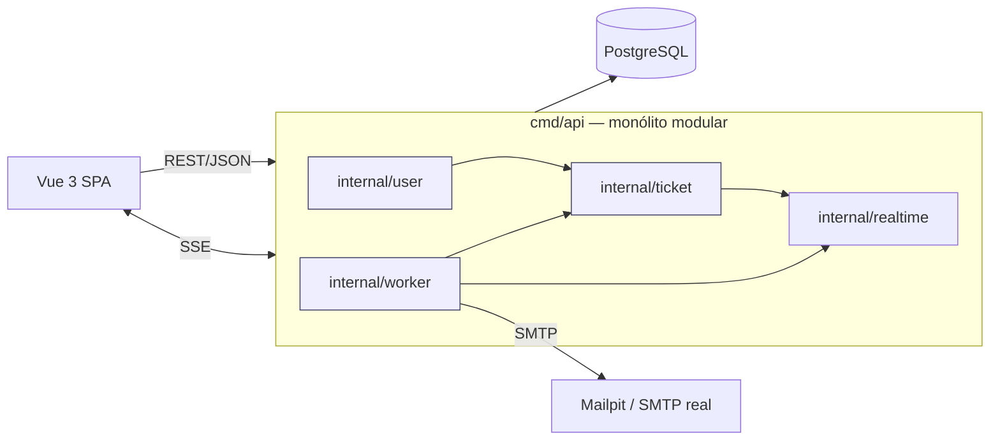
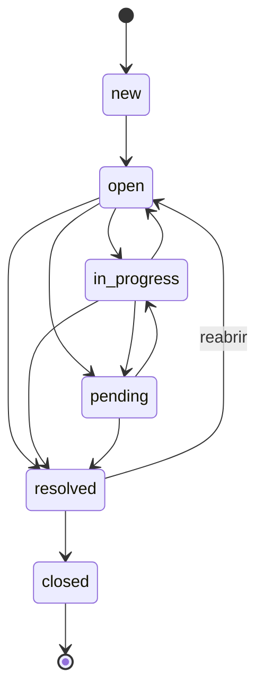
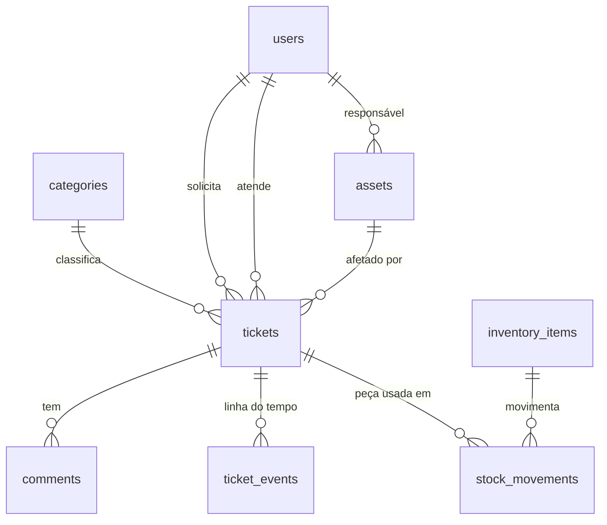

# GoTicket — Arquitetura e Estratégia

## 1. Visão e escopo

**Problema:** equipes de suporte precisam de um fluxo de chamados rastreável, com prazos (SLA)
e visibilidade em tempo real — o núcleo do que plataformas como ServiceNow oferecem — sem o peso
de uma suíte completa.

**Princípios**
1. **Domínio primeiro:** regras de estado e SLA vivem em `internal/ticket`, não em handlers nem no frontend.
2. **Monólito modular:** um binário, pacotes com fronteiras claras; extração futura só se houver dor real.
3. **Simples de operar:** Postgres + um processo. Sem broker, sem cache, até o volume exigir.
4. **O servidor é a fonte de verdade:** o frontend nunca decide permissão nem transição válida.

**Fora do escopo (v1):** CMDB completo (relacionamentos entre ativos), workflows visuais, catálogo de serviços, multi-tenant, anexos.

**Módulos:** chamados (incidentes), ativos (inventário de equipamentos), estoque (peças e consumíveis) e painel (indicadores). Eles se conectam no atendimento: o chamado aponta o **ativo afetado** e registra as **peças consumidas**.

## 2. Arquitetura

| Pacote | Responsabilidade | Depende de |
|---|---|---|
| `cmd/api` | composição, rotas, graceful shutdown | todos |
| `internal/ticket` | estados, prioridade/SLA, service, repository | `user` (Claims), `realtime` (evento) |
| `internal/user` | cadastro, login, JWT, middleware, papéis | — |
| `internal/asset` | inventário de equipamentos, responsável e ciclo de vida | `user` |
| `internal/inventory` | estoque de peças, movimentações atômicas, vínculo com chamado | `realtime`, `user` |
| `internal/report` | agregações do painel (KPIs, séries, distribuições) | — |
| `internal/realtime` | hub SSE com filtro por perfil | `user` |
| `internal/worker` | varredura de SLA, notificação por e-mail | `ticket` |
| `internal/database` | conexão pgx e migrações | — |
| `internal/httpx` | helpers JSON (adicionado ao esqueleto original) | — |

**Integração entre módulos sem acoplamento:** `ticket` declara as interfaces `Directory` e `Assets`
que precisa; `user.Service` e `asset.Service` as satisfazem implicitamente. O domínio de chamados
não importa os pacotes de ativos nem de usuários para consultá-los.

**Regra de dependência:** domínio não conhece HTTP. `ticket.Service` depende das interfaces
`Repository` e `Publisher`, o que permite testar sem banco e trocar o transporte de eventos.

## 3. Modelo de domínio

- **Número do ticket** (`INC0000001`) gerado por sequence no banco: sem colisão, sem lógica na app.
- **SLA por prioridade:** crítica 4h · alta 8h · média 24h · baixa 72h, calculado na criação
  (`sla_due_at`). Violação é um fato persistido (`sla_breached`), não recalculado em tela.
- **Visibilidade:** cliente vê só os próprios tickets (404 e não 403 para não vazar existência);
  **notas internas** só para agentes — filtradas na query, no SSE e na criação.

### Modelo de dados (resumo)

- **Ativo:** etiqueta `AST000001` (sequence), tipo, série, local, garantia e status
  (`in_stock → in_use ↔ maintenance → retired`). Atribuir a alguém coloca em uso; devolver ou baixar remove o responsável.
- **Estoque:** `quantity` nunca fica negativa (CHECK + condição no UPDATE). Cada entrada, saída ou ajuste gera uma
  linha em `stock_movements`; a saída vinculada a um chamado também grava na linha do tempo dele, na mesma transação.
- **Linha do tempo (`ticket_events`):** auditoria imutável de criação, mudanças de status, atribuições e peças usadas.
- **Cliente e ativos:** cliente só vincula a um chamado ativos que estão sob a sua responsabilidade.

## 4. Decisões (ADRs)

**ADR-001 — Monólito modular em vez de microsserviços.** Time pequeno, domínio coeso. Custo de
rede, deploy e consistência distribuída não se paga. *Reavaliar* se o worker precisar escalar de forma independente.

**ADR-002 — PostgreSQL apenas (SQLite descartado no v1).** Índice parcial para o SLA,
`UPDATE ... RETURNING` atômico e sequences dependem de recursos do Postgres; manter dois dialetos duplicaria testes.

**ADR-003 — SSE em vez de WebSocket.** O fluxo é servidor→cliente; ações do usuário já passam por REST.
SSE é stdlib, atravessa proxies HTTP comuns e reconecta automaticamente. *Trade-off:* sem canal
bidirecional (indicador "digitando…" exigiria WebSocket) e limite de ~6 conexões/domínio em HTTP/1.1.

**ADR-004 — JWT stateless (HS256), 12h, enviado por header; `?token=` só para o SSE.**
`EventSource` não envia headers. *Risco:* token em URL aparece em logs de proxy.
*Mitigação planejada:* endpoint de "ticket de uso único" curto (30 s) para abrir o stream.

**ADR-005 — Worker no mesmo processo.** `MarkSLABreached` usa `UPDATE ... RETURNING`, então cada violação
é entregue uma única vez mesmo com várias instâncias. Isso permite escalar horizontalmente sem leader election.

**ADR-006 — Migrações SQL simples, versionadas por nome de arquivo.** Sem ORM nem ferramenta externa;
migração futura para `goose`/`atlas` é direta porque os arquivos já são SQL puro.

**ADR-007 — Saldo de estoque protegido no banco.** `UPDATE ... SET quantity = quantity + $d WHERE quantity + $d >= 0`
dentro de uma transação com o registro da movimentação. Duas baixas simultâneas da última unidade não geram saldo negativo,
sem precisar de locks explícitos na aplicação. *Trade-off:* sem reserva de peça antes do uso (planejado na fase 3).

**ADR-008 — Gráficos em SVG próprio, sem biblioteca.** Três componentes pequenos (linha, barras, rosca) cobrem o painel,
sem dependência extra e sem custo de bundle. *Reavaliar* (Chart.js/ECharts) se surgirem zoom, tooltips ricos ou exportação.

**ADR-009 — Agregações do painel em SQL, num único endpoint.** `GET /api/reports/summary` devolve tudo que o painel precisa
em uma chamada, restrito a agentes. O painel recarrega quando chega um evento em tempo real. *Risco:* custo cresce com o volume;
mitigar com índices por data, cache curto ou *materialized views*.

## 5. Estratégia de frontend (Vue)

- **Stack:** Vue 3 (`<script setup>`), Vite, Pinia, Vue Router. Sem biblioteca de UI no início:
  o CSS atual cabe em um arquivo e evita lock-in.
- **Navegação por perfil:** cliente vê só "Chamados"; agente vê Painel, Chamados, Ativos e Estoque. As rotas de agente
  também são protegidas no router, e o servidor é quem realmente barra (403).
- **Camadas:** `api.js` (HTTP + JWT) → `stores/` (estado e tempo real) → `views/` (telas).
  Componentes não chamam `fetch` diretamente.
- **Tempo real:** um único `EventSource` aberto após o login, gerenciado pela store de tickets.
  Eventos disparam recarga pontual; o estado nunca é derivado do evento sozinho (evita divergência).
- **Permissões na UI:** esconder botões é só UX. `NEXT` em `labels.js` espelha a máquina de estados do
  backend; divergência resulta em 409, não em estado inválido.
- **Evolução:** migrar para TypeScript e gerar tipos a partir de um OpenAPI quando a API passar de ~15 rotas;
  adicionar Vitest (stores) e Playwright (fluxo cliente→agente).

## 6. Segurança

| Ameaça | Controle atual | Próximo passo |
|---|---|---|
| Senhas vazadas | bcrypt (cost padrão) | política de senha, rate limit no login |
| Acesso indevido a ticket | checagem no service (`load`) | testes de autorização por perfil |
| Escalada de papel | cadastro público só cria `customer`; agente via seed | tela admin para convidar agentes |
| Payload abusivo | `MaxBytesReader` 1 MB, `DisallowUnknownFields` | rate limit global |
| XSS | Vue escapa por padrão; sem `v-html` | CSP no proxy reverso |
| Token em localStorage | simples para v1 | cookie `HttpOnly` + CSRF token em produção |
| `assigneeId` arbitrário | service valida que o destino é agente | — |
| Cliente vendo estoque/ativos de terceiros | rotas de estoque, painel e usuários restritas a agente; ativos filtrados por responsável | testes de autorização por rota |
| Baixa de estoque concorrente | condição atômica no UPDATE (ADR-007) | teste de integração com concorrência |

## 7. Observabilidade e operação

- Logs estruturados (`slog`), `/healthz` com ping ao banco.
- Graceful shutdown: o contexto de sinal cancela o worker e drena o `http.Server` em até 10 s.
- Próximos passos: métricas Prometheus (tickets abertos, violações de SLA, latência), request-id nos logs.

## 8. Estratégia de testes

1. **Unitários de domínio** (já iniciados em `domain_test.go`): transições e SLA, sem banco.
2. **Service com repository fake:** regras de permissão e eventos publicados.
3. **Integração com Postgres** (testcontainers ou o compose): repository e migrações.
4. **E2E:** cliente abre chamado → agente assume e resolve → cliente vê atualização ao vivo.

## 9. Riscos

| Risco | Impacto | Mitigação |
|---|---|---|
| Hub SSE em memória não funciona com várias instâncias | Eventos perdidos entre nós | Postgres `LISTEN/NOTIFY` ou Redis pub/sub quando houver >1 instância |
| Worker enviando e-mail inline atrasa a varredura | Notificações lentas | Fila de outbox (tabela) com retry |
| Token em query string | Vazamento em logs | Ticket de uso único (ADR-004) |

## 10. Roadmap

| Fase | Entrega |
|---|---|
| **0 — Esqueleto (atual)** | Auth, tickets, comentários, SLA, SSE, UI básica |
| **1 — Operação do agente (entregue em parte)** | ✅ Painel, ativos, estoque, categorias, filas "meus/sem agente", busca, atribuição validada · ⏳ grupos de atendimento, paginação |
| **2 — Confiabilidade** | Testes de integração, rate limit, outbox de e-mails, métricas |
| **3 — ITSM** | Reserva de peças, histórico de ativo (chamados e donos), alerta de estoque mínimo por e-mail, base de conhecimento, pausa de SLA em "Aguardando cliente", pesquisa de satisfação |
| **4 — Escala** | `LISTEN/NOTIFY`, multi-tenant, anexos em object storage |

## 11. Limitações conhecidas do esqueleto

- O SLA não pausa em `pending` (planejado na fase 3).
- Paginação ausente: listagens retornam até 200 chamados e 300 ativos.
- Ativos não têm histórico próprio (donos anteriores) nem relacionamentos (CMDB completo).
- Estoque sem reserva, custo unitário ou fornecedor.
- Troca de categoria e de ativo de um chamado já criado ainda não está na interface.
- O demo (`make demo`) é apenas para desenvolvimento.
- Código ainda não compilado no ambiente de geração; execute `go vet` e `go test` antes de qualquer coisa.
